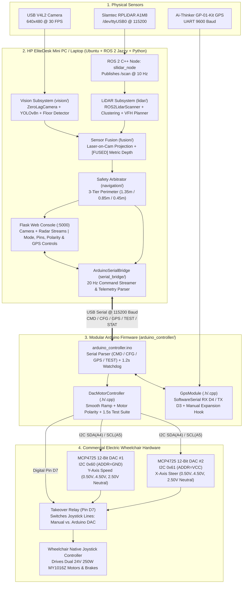
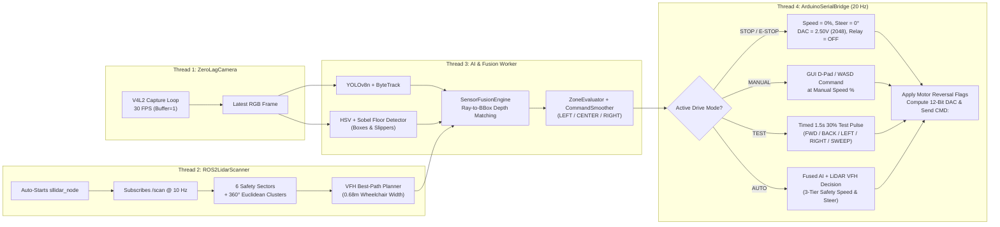
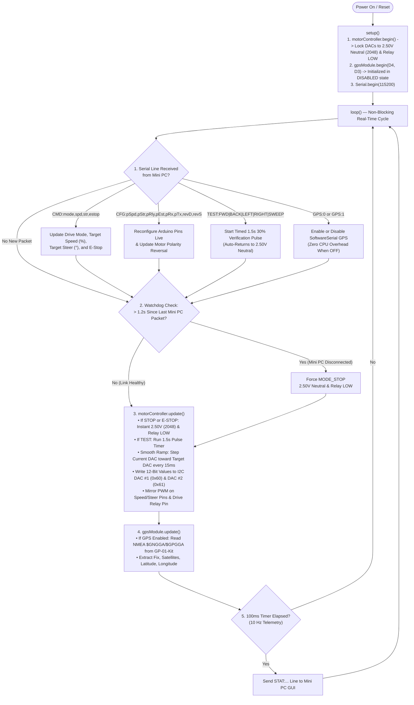
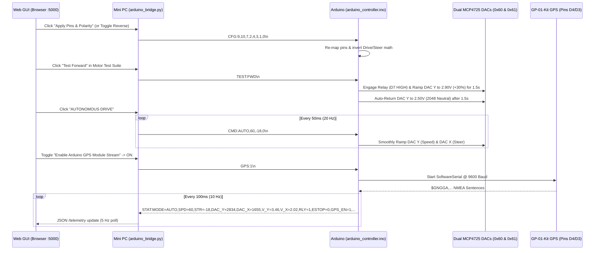

# Autonomous Smart Wheelchair
### AI Computer Vision, 360° RPLiDAR Mapping, Multi-Sensor Fusion & Dual-DAC Motor Control

> **Mechatronics Engineering Graduation Project**  
> An intelligent perception, obstacle-avoidance, and autonomous navigation system built on a **full-scale commercial electric wheelchair** (`MY1016Z 24V 250W` dual brushed geared motors). Powered by an on-board **HP EliteDesk Mini PC** (Ubuntu + ROS 2 Jazzy) connected over USB Serial (`115200` baud) to a **modular Arduino controller** driving **Dual 12-Bit MCP4725 DACs** into the wheelchair's native joystick circuit.

---

## Project Status & Subsystems

| Subsystem | Module Path | Status | Key Capabilities |
| :--- | :--- | :---: | :--- |
| **1. AI Camera Vision** | `wheelchair_vision/vision/` | **Done** | Zero-lag 30 FPS V4L2 capture, YOLOv8n + ByteTrack tracking, custom floor hazard segmentation (boxes, slippers). |
| **2. 360° LiDAR & VFH Planner** | `wheelchair_vision/lidar/` | **Done** | ROS 2 `/scan` @ 10 Hz auto-launcher, 6 safety sectors, Euclidean obstacle clustering, VFH path finder, 2D BEV Radar. |
| **3. Camera + LiDAR Fusion** | `wheelchair_vision/fusion/` | **Done** | Frontal laser-on-camera projection, true metric depth on AI boxes (`[FUSED]`), complementary floor-hazard radar markers. |
| **4. Safety Brain & Arbitrator** | `wheelchair_vision/navigation/` | **Done** | 3-Tier safety perimeter (`1.35m` slow / `0.85m` reroute / `0.45m` stop), flank blind-spot check, instant `Spacebar` E-Stop. |
| **5. Mini PC Serial Bridge** | `wheelchair_vision/serial_bridge/` | **Done** | 20 Hz bidirectional serial link (`115200` baud), Drive Mode arbitration (`STOP`, `MANUAL`, `TEST`, `AUTO`), simulated DAC preview. |
| **6. Modular Arduino Firmware** | `arduino_controller/` | **Done** | Dual MCP4725 12-bit I2C DAC controller (`0x60`/`0x61` & `0x62`/`0x63`), runtime pin & motor polarity customization, 1.5s test pulses, `GpsModule` (`GP-01-Kit`) with live GUI ON/OFF switch. |
| **7. Web Control Console** | `wheelchair_vision/web/` | **Done** | Dual-stream visualization (Camera + 360° LiDAR), Manual D-Pad, Motor Test Suite, live Pin/Polarity config, and GPS panel. |

---

## 1. Visual System Architecture (End-to-End Hardware & Software Flow)



---

## 2. Visual Flow of the Python Backend (`main.py` & `wheelchair_vision/`)

Four parallel threads run inside `main.py` so the video stream, AI inference, ROS 2 LiDAR scanning, and Arduino serial communication never block each other:



---

## 3. Visual Flow of the Modular Arduino Code (`arduino_controller/`)

### How the Arduino Loop Works Step by Step



### Mini PC $\leftrightarrow$ Arduino Serial Sequence Diagram



---

## 4. Wiring the Future Electronics Red MCP4725 (12-Bit DAC) Boards

You need **two (2) MCP4725 modules** (one for **Y-Axis Speed / Forward-Back**, one for **X-Axis Steer / Left-Right**). Both share the exact same Arduino I2C pins (`A4` and `A5`), distinguished by the **`ADDR` solder pad** on the right side of the red board:

| Module | Role | How to Set the `ADDR` Pad on the Red Board | I2C Address (Auto-Detected) |
| :--- | :--- | :--- | :---: |
| **MCP4725 #1** | **Speed (Y-Axis)** | Leave default (`ADDR` connected to `GND`) | **`0x60`** *(or `0x62`)* |
| **MCP4725 #2** | **Steer (X-Axis)** | Bridge a tiny drop of solder between **`ADDR` and `VCC`** | **`0x61`** *(or `0x63`)* |

### Complete Arduino-to-DAC-to-Wheelchair Pinout

| From Component | Pin Name | To Arduino Uno / Nano Pin | Customizable in GUI? |
| :--- | :--- | :--- | :---: |
| **Both MCP4725 DACs** | `VCC` | Arduino **`5V`** | Fixed Power |
| **Both MCP4725 DACs** | `GND` | Arduino **`GND`** *(Must share common GND with Wheelchair Joystick!)* | Fixed Ground |
| **Both MCP4725 DACs** | `SDA` | Arduino **`A4`** (`SDA`) | Hardware I2C |
| **Both MCP4725 DACs** | `SCL` | Arduino **`A5`** (`SCL`) | Hardware I2C |
| **MCP4725 #1 (Speed)** | `OUT` | Wheelchair Joystick **Y-Axis (Forward/Reverse)** wire *(via Takeover Relay)* | — |
| **MCP4725 #2 (Steer)** | `OUT` | Wheelchair Joystick **X-Axis (Left/Right)** wire *(via Takeover Relay)* | — |
| **Aux Speed PWM** | PWM Out | Arduino **Pin `9`** | **Yes (in GUI)** |
| **Aux Steer PWM** | PWM Out | Arduino **Pin `10`** | **Yes (in GUI)** |
| **Takeover Relay** | `IN` | Arduino **Pin `7`** (`HIGH` = Arduino drives chair; `LOW` = Manual Joystick) | **Yes (in GUI)** |
| **Hardware E-Stop** | Switch | Arduino **Pin `2`** | **Yes (in GUI)** |
| **GP-01-Kit GPS** | `TX` | Arduino **Pin `4`** (`GPS RX Pin`) | **Yes (in GUI)** |
| **GP-01-Kit GPS** | `RX` | Arduino **Pin `3`** (`GPS TX Pin`) | **Yes (in GUI)** |

---

## 5. Repository File Map

```
Graduation Project Mecha/
├── main.py                                  # Main Entrypoint (Auto-loads ROS 2, Vision, LiDAR, Fusion, Serial & GUI)
├── requirements.txt                         # Python dependencies (opencv-python, ultralytics, numpy, flask, pyserial)
├── README.md                                # Complete system documentation & visual flowcharts
│
├── arduino_controller/                      # Modular Arduino Firmware (Flash with Arduino IDE or arduino-cli)
│   ├── arduino_controller.ino               # Serial dispatcher (CMD/CFG/GPS/TEST), 1.2s watchdog & 10 Hz telemetry
│   ├── Config.h                             # Default pins, DAC calibration (2048 = 2.50V neutral), timing constants
│   ├── DacMotorController.h                 # Motor & Dual MCP4725 DAC controller interface
│   ├── DacMotorController.cpp               # I2C DAC writer (0x60/0x61 + 0x62/0x63 auto-fallback), ramping & test suite
│   ├── GpsModule.h                          # GPS UART module interface (live GUI ON/OFF control)
│   └── GpsModule.cpp                        # Lightweight NMEA parser + marked placeholders for manual GPS code
│
└── wheelchair_vision/                       # Core Modular Python Package
    ├── config.py                            # Centralized settings (Camera, LiDAR safety rings, Arduino & DAC defaults)
    ├── vision/                              # Subsystem 1: Camera Perception (ZeroLagCamera, YOLOv8n, Floor Detector)
    ├── lidar/                               # Subsystem 2: 360° RPLiDAR A1M8 (ROS 2 /scan node, clustering, VFH, BEV Radar)
    ├── fusion/                              # Subsystem 3: Sensor Fusion (Laser-on-Camera projection & [FUSED] depth)
    ├── navigation/                          # Subsystem 4: 3-Tier Safety Arbitrator & Temporal Smoother
    ├── serial_bridge/                       # Subsystem 5: Mini PC <-> Arduino Serial Bridge
    │   └── arduino_bridge.py                # 20 Hz command streamer, simulated DAC preview, pin/polarity & GPS sync
    └── web/                                 # Subsystem 6: Web Control Console (:5000)
        ├── app.py                           # Flask REST API (/video_feed, /lidar_feed, /telemetry, /api/*)
        ├── streamer.py                      # Fused Camera HUD renderer & MJPEG streamer
        └── templates/index.html             # Modern dark-mode Control Console (No emojis)
```

---

## 6. How to Test the GUI on Your Laptop Right Now

You can test the **entire GUI, Manual Drive, Motor Test Suite, Pin Customization, Motor Reversal, and GPS Toggle** on your laptop even without the Arduino or LiDAR plugged in (it automatically runs in **Simulated DAC Preview Mode** so you can watch the exact DAC voltages $0.50\text{ V}\text{–}4.50\text{ V}$ change live):

### Step 1: Start the Server
Open your terminal and run:
```bash
cd "/home/mohamed-khairy/Graduation Project Mecha"
./venv/bin/python3 main.py
```

### Step 2: Open the Console in Your Browser
Go to: **[http://localhost:5000](http://localhost:5000)**

### Step 3: Interactive Walkthrough in the Browser
1. **Test Pre-Autonomous Motor Pulses**:
   * In **Panel 1**, click **`Test Forward`**, **`Test Reverse`**, **`Test Left`**, or **`Run Full 4-Direction Motor Verification Sweep`**.
   * Watch **`DAC Y (0x60 Speed)`** and **`DAC X (0x61 Steer)`** jump from **`2.50V (2048)`** to **`3.10V (2539)`** or **`1.90V (1557)`** for `1.5 seconds` and automatically return to **`2.50V (2048)`** neutral.
2. **Test Motor Polarity Reversal & Pin Customization**:
   * In **Panel 2**, toggle **`Reverse Drive Motor (Forward / Backward)`** ON, then click **`Test Forward`** again—notice the DAC voltage now swings in the opposite direction (`1.90V` instead of `3.10V`).
   * Change any pin number and click **`Apply Pins & Polarity to Arduino`**.
3. **Test Manual Drive**:
   * Click **`MANUAL DRIVE`**, adjust the **`Manual Drive Speed`** slider, and click **`FORWARD [W]`**, **`TURN LEFT [A]`**, **`TURN RIGHT [D]`**, **`REVERSE [X]`**, or **`STOP [S]`** (or use your keyboard `W/A/S/D/X` keys).
4. **Test Autonomous Drive & Emergency Stop**:
   * Click **`AUTONOMOUS DRIVE`** to let the AI Camera + 360° LiDAR VFH path planner control the DAC voltages automatically.
   * Press **`Spacebar`** (or click **`EMERGENCY STOP`**) at any time to lock output to `0%` (`2.50V` neutral) and disengage the relay.
5. **Test the GPS Toggle**:
   * In **Panel 3**, toggle **`Enable Arduino GPS Module Stream`** ON and OFF.
