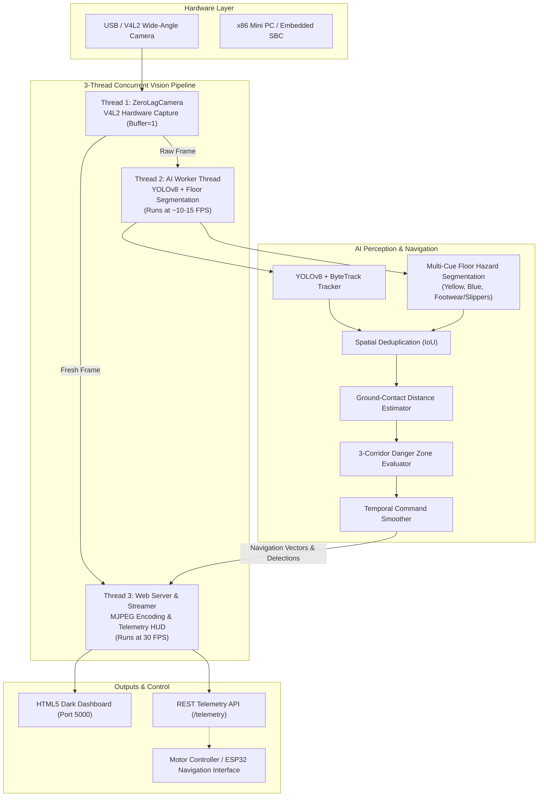

# 🦼 Autonomous Smart Wheelchair: Real-Time AI Vision & Obstacle Avoidance System

> **Mechatronics Engineering Graduation Project**  
> A high-performance, edge-optimized Computer Vision and AI Obstacle Avoidance pipeline designed for assistive smart wheelchairs. Combines deep learning object tracking, multi-cue ground plane hazard segmentation, dynamic danger corridor mapping, and ultra-low-latency web telemetry.

---

## 📌 Table of Contents
- [System Overview](#-system-overview)
- [Key Features](#-key-features)
- [Architecture & Dataflow](#-architecture--dataflow)
- [Core Algorithms & Vision Techniques](#-core-algorithms--vision-techniques)
  - [1. Zero-Lag 3-Thread Concurrent Pipeline](#1-zero-lag-3-thread-concurrent-pipeline)
  - [2. Deep Learning Object Tracking (YOLOv8 + ByteTrack)](#2-deep-learning-object-tracking-yolov8--bytetrack)
  - [3. Multi-Cue Floor Horizon Hazard Detection](#3-multi-cue-floor-horizon-hazard-detection)
  - [4. Dynamic Danger Zone & Ground-Contact Distance Estimation](#4-dynamic-danger-zone--ground-contact-distance-estimation)
  - [5. Temporal Command Smoothing & Navigation Decision Logic](#5-temporal-command-smoothing--navigation-decision-logic)
- [Project Structure](#-project-structure)
- [Installation & Setup](#-installation--setup)
  - [Prerequisites](#prerequisites)
  - [Local Setup](#local-setup)
  - [Remote Mini PC Deployment (via Ethernet / WiFi)](#remote-mini-pc-deployment-via-ethernet--wifi)
- [Usage & Running](#-usage--running)
- [Web Telemetry & REST API](#-web-telemetry--rest-api)
- [Configuration Parameters](#-configuration-parameters)
- [Development Milestones (Legacy Prototypes)](#-development-milestones-legacy-prototypes)
- [License & Acknowledgments](#-license--acknowledgments)

---

## 🌟 System Overview

Assistive smart wheelchairs require fast, robust, and dependable obstacle detection to guarantee passenger safety. Traditional deep-learning detectors often fail on low-profile, unclassified floor hazards (such as cardboard boxes, stray cables, or slippers) or introduce severe frame latency when running on embedded CPU hardware.

This project delivers a **hybrid perception and navigation guidance system** tailored specifically for edge deployment on an on-board Mini PC. It pairs **Ultralytics YOLOv8** with a **custom multi-cue ground plane segmentation algorithm**, ensuring that both recognized objects (people, chairs, obstacles) and arbitrary ground hazards are detected with zero video lag.

---

## 🚀 Key Features

- **⚡ Zero-Lag Asynchronous Video Streaming**: Decoupled 3-thread architecture guarantees a smooth 30 FPS video feed regardless of AI inference time.
- **🧠 Hybrid AI Perception**:
  - **YOLOv8 Object Detection & ByteTrack**: Real-time identification and trajectory history tracking.
  - **Multi-Cue Floor Hazard Segmentation**: Custom color/gradient horizon segmentation to catch unclassified ground objects (boxes, slippers, footwear).
- **📐 Ground-Contact Distance Estimation**: Calculates physical obstacle distance based on ground-plane contact points and camera mounting geometry.
- **🛡️ 3-Zone Dynamic Corridor Evaluation**: Segregates camera field of view into Left, Center, and Right corridors with configurable safety danger lines.
- **🔄 Temporal Command Smoothing**: Windowed majority-voting filter suppresses transient false positives and eliminates motor control jitter.
- **🌐 Responsive Web Telemetry HUD**: Embedded Flask dashboard streaming live annotated video with real-time HUD overlays, FPS metrics, and RESTful telemetry endpoints.

---

## 🏗️ Architecture & Dataflow



---

## 🔬 Core Algorithms & Vision Techniques

### 1. Zero-Lag 3-Thread Concurrent Pipeline
Standard single-threaded OpenCV loops block the camera capture while waiting for heavy deep-learning inference, causing OpenCV's internal V4L2 buffer to fill with stale frames. This leads to latency that grows over time.

Our solution decouples execution across 3 specialized threads:
1. **Camera Thread (`ZeroLagCamera`)**: Continuously drains the hardware camera buffer (`cv2.CAP_PROP_BUFFERSIZE = 1`). Whenever a fresh frame arrives, older ones are immediately discarded.
2. **AI Inference Thread (`ai_worker_loop`)**: Runs YOLOv8 inference, multi-cue floor hazard segmentation, distance calculation, and command synthesis asynchronously. Writes current detections to a thread-safe `SharedState`.
3. **Web Streamer Thread (`FrameStreamer`)**: Pulls the newest raw frame from Thread 1, overlays the latest bounding boxes and HUD diagnostics from Thread 2, encodes it into MJPEG, and delivers it to connected browser clients at 30 FPS.

### 2. Deep Learning Object Tracking (YOLOv8 + ByteTrack)
- **Model**: YOLOv8 Nano (`yolov8n.pt`) with input resolution downscaled to 320x320 for rapid CPU inference.
- **ByteTrack Integration**: Assigns persistent track IDs across frames and tracks moving objects with velocity vectors and trajectory trails.
- **Footprint Extraction**: Extracts the bottom center $(x_{mid}, y_2)$ as the ground-contact point.

### 3. Multi-Cue Floor Horizon Hazard Detection
To catch low-profile hazards that deep learning models frequently miss, a specialized computer-vision algorithm inspects the ground plane below a calibrated horizon:
- **Spatial ROI**: Constrained to the lower 65% of the frame (the floor area immediately ahead of the wheelchair wheels).
- **Cue A (Warm / Yellow Obstacles)**: HSV color thresholding isolating yellow and warm-toned cardboard boxes.
- **Cue B (Cool / Blue Obstacles)**: HSV thresholding tuned for high-saturation cool objects.
- **Cue C (Dark Footwear / Slippers)**: Adaptive low-value brightness filtering coupled with local vertical Sobel gradient energy and ground-sole extension.
- **Deduplication**: Computes Intersection-over-Union (IoU) between custom floor candidates and YOLO detections to avoid redundant bounding boxes.

### 4. Dynamic Danger Zone & Ground-Contact Distance Estimation
- **Perspective Geometry**: Approximates physical distance $D$ in meters using the vertical coordinate of the obstacle's bottom edge ($y_2$):
  $$\text{norm\_y} = \frac{y_2 - y_{min}}{y_{max} - y_{min}}$$
  $$\text{Distance (m)} = D_{max} \cdot (1 - \text{norm\_y})^2 + D_{min}$$
- **Corridor Division**: The screen width is partitioned into three vertical sectors:
  - **Left Corridor**: $0 \le x < 0.35 \times W$
  - **Center Corridor**: $0.35 \times W \le x \le 0.65 \times W$
  - **Right Corridor**: $0.65 \times W < x \le W$
- **Danger Threshold**: A dynamic horizontal danger line ($y = 0.58 \times H$). If an obstacle's ground-contact point crosses below this threshold, the corresponding corridor is flagged as `BLOCKED`.

### 5. Temporal Command Smoothing & Navigation Decision Logic
To prevent jerky steering caused by transient detection fluctuations, raw corridor flags pass through a **Windowed Majority-Voting Filter** (`CommandSmoother`):
- Each corridor's blocked state is recorded over a sliding window ($N = 3$ frames).
- An obstacle is only deemed blocking if present in at least 2 of the last 3 frames.

**Steering Decision Matrix**:
| Center Zone | Left Zone | Right Zone | Navigation Command | Recommended Steering Angle | Speed % |
|:-----------:|:---------:|:----------:|:------------------:|:--------------------------:|:-------:|
| Clear       | Clear     | Clear      | `FORWARD`          | $0^\circ$                  | 100%    |
| Blocked     | Clear     | Blocked    | `STEER LEFT`       | $-25^\circ$                | 45%     |
| Blocked     | Blocked   | Clear      | `STEER RIGHT`      | $+25^\circ$                | 45%     |
| Blocked     | Clear     | Clear      | `AVOID (SLIGHT L)` | $-15^\circ$                | 50%     |
| Blocked     | Blocked   | Blocked    | `STOP (BLOCKED)`   | $0^\circ$                  | 0%      |

---

## 📁 Project Structure

```
Graduation Project Mecha/
├── main.py                     # Primary entrypoint (CLI runner & thread orchestrator)
├── requirements.txt            # Python dependencies
├── .gitignore                  # Git ignore rules (weights, venv, caches)
├── README.md                   # System documentation
│
├── wheelchair_vision/          # Core Modular Vision Package
│   ├── __init__.py             # Package root
│   ├── config.py               # Centralized configuration dataclass
│   │
│   ├── vision/                 # Computer Vision & Perception
│   │   ├── __init__.py
│   │   ├── camera.py           # ZeroLagCamera (V4L2 hardware capture thread)
│   │   ├── yolo_detector.py    # YOLOv8 + ByteTrack object detector
│   │   └── floor_detector.py   # Multi-cue floor horizon segmentation
│   │
│   ├── navigation/             # Navigation & Decision Logic
│   │   ├── __init__.py
│   │   ├── danger_zone.py      # ZoneEvaluator & Ground distance estimation
│   │   └── smoother.py         # Temporal CommandSmoother & Steering matrix
│   │
│   └── web/                    # Telemetry Server & Web HUD
│       ├── __init__.py
│       ├── app.py              # Flask application factory & REST routes
│       ├── streamer.py         # FrameStreamer (HUD overlays & MJPEG stream)
│       └── templates/
│           └── index.html      # Responsive dark-theme dashboard UI
│
└── legacy/                     # Step-by-Step Evolutionary Prototypes
    ├── README.md               # Explanation of development stages
    ├── step1_camera_test.py    # Milestone 1: Hardware camera test
    ├── step2_yolo_obstacle_detector.py  # Milestone 2: Basic YOLO detection
    ├── step3_advanced_robot_vision.py   # Milestone 3: Tracking & floor cues
    └── step4_web_dashboard.py # Milestone 4: Monolithic prototype
```

---

## 💻 Installation & Setup

### Prerequisites
- **Operating System**: Linux (Ubuntu 20.04/22.04 LTS recommended)
- **Python**: 3.10 or higher
- **Camera**: Any USB V4L2 webcam (wide-angle lens recommended)

### Local Setup
```bash
# 1. Clone the repository
git clone git@github.com:khairycse404/smart-wheelchair-vision.git
cd smart-wheelchair-vision

# 2. Create and activate a Python virtual environment
python3 -m venv venv
source venv/bin/activate

# 3. Install dependencies
pip install --upgrade pip
pip install -r requirements.txt

# 4. Download lightweight YOLOv8 weights (if not already present)
python -c "from ultralytics import YOLO; YOLO('yolov8n.pt')"
```

### Remote Mini PC Deployment (via Ethernet / WiFi)
When running headlessly on the wheelchair's on-board Mini PC:
```bash
# SSH into the Mini PC
ssh mahmoud-bahlol@10.0.0.2

# Navigate to project directory
cd ~/Graduation\ Project\ Mecha

# Launch the vision system bound to all network interfaces
python3 main.py --host 0.0.0.0 --port 5000
```
Open your laptop browser and navigate to:  
👉 **`http://10.0.0.2:5000`**

---

## 🎮 Usage & Running

```bash
# Standard launch with default settings (port 5000)
python3 main.py

# Custom host IP and port
python3 main.py --host 192.168.1.100 --port 8080
```

### CLI Arguments
| Flag | Default | Description |
|:-----|:-------:|:------------|
| `--host` | `0.0.0.0` | IP interface to bind the web server |
| `--port` | `5000` | Port for the web dashboard and MJPEG stream |

---

## 🌐 Web Telemetry & REST API

The system provides a built-in REST API allowing external microcontrollers (e.g., ESP32, Arduino, or ROS nodes) to poll real-time obstacle avoidance state:

### 1. Telemetry Endpoint: `GET /telemetry`
Returns live JSON data containing FPS rates, active navigation commands, corridor clearance, and obstacle counts.

**Sample Response**:
```json
{
  "fps": 30.1,
  "ai_fps": 14.8,
  "command": "FORWARD",
  "steer_deg": 0,
  "speed_pct": 100,
  "closest_dist_m": 1.85,
  "left_zone": "CLEAR",
  "center_zone": "CLEAR",
  "right_zone": "CLEAR",
  "objects_count": 2
}
```

### 2. Video Feed: `GET /video_feed`
Streams high-speed multipart MJPEG video directly compatible with `` tags in web browsers or OpenCV `cv2.VideoCapture` clients.

### 3. Interactive Web Dashboard: `GET /`
Modern, dark-mode user interface displaying the live video HUD, corridor status indicators, navigation command badges, and interactive controls to adjust danger thresholds in real time.

---

## ⚙️ Configuration Parameters

All system hyperparameters are centralized in [`wheelchair_vision/config.py`](file:///home/mohamed-khairy/Graduation%20Project%20Mecha/wheelchair_vision/config.py):

| Parameter | Default | Purpose |
|:----------|:-------:|:--------|
| `CAPTURE_WIDTH` / `HEIGHT` | `640 x 480` | Native camera resolution (4:3 aspect ratio provides maximum vertical field of view) |
| `YOLO_IMGSZ` | `320` | Downscaled input resolution for YOLO inference (optimizes CPU throughput) |
| `CONFIDENCE_THRESHOLD` | `0.35` | Minimum confidence score for YOLO detections |
| `DEFAULT_DANGER_Y_RATIO` | `0.58` | Vertical position of the safety danger line (fraction of frame height) |
| `USE_UNKNOWN_HELPER` | `True` | Enables the multi-cue floor horizon hazard segmentation |
| `JPEG_QUALITY` | `80` | MJPEG streaming compression quality (balanced clarity vs. bandwidth) |

---

## 📜 Development Milestones (Legacy Prototypes)

The [`legacy/`](file:///home/mohamed-khairy/Graduation%20Project%20Mecha/legacy) folder retains the step-by-step engineering progression for academic review:
- `step1_camera_test.py`: V4L2 camera latency and FPS testing.
- `step2_yolo_obstacle_detector.py`: Proof-of-concept YOLOv8 integration.
- `step3_advanced_robot_vision.py`: ByteTrack and multi-cue floor hazard segmentation prototype.
- `step4_web_dashboard.py`: Early monolithic prototype combining AI and web streaming.

---

## 👥 Contributors & Acknowledgments
- **Mechatronics Engineering Graduation Project Team**
- Built with [OpenCV](https://opencv.org/), [Ultralytics YOLOv8](https://github.com/ultralytics/ultralytics), and [Flask](https://flask.palletsprojects.com/).
