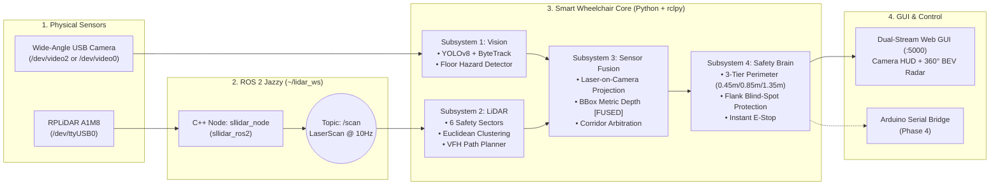

# 🦼 Autonomous Smart Wheelchair
### AI Computer Vision, 360° LiDAR Mapping & Multi-Sensor Fusion
 
> An intelligent perception, obstacle-avoidance, and autonomous navigation system built on a **full-scale commercial electric wheelchair**. Powered by an on-board **HP EliteDesk Mini PC** (Ubuntu + ROS 2 Jazzy), combining **YOLOv8 AI Vision**, **360° Slamtec RPLiDAR A1M8**, **Multi-Sensor Fusion**, and an **Arduino** motor interface.

---

## ⚡ Project Status & Roadmap

| Phase | Subsystem | Status | Key Capabilities |
| :--- | :--- | :---: | :--- |
| **Phase 1** | **AI Camera Vision** (`vision/`) | 🟢 **Done** | Zero-lag 30 FPS capture, YOLOv8n + ByteTrack, custom floor hazard segmentation (boxes, slippers). |
| **Phase 2** | **360° LiDAR & Path Planner** (`lidar/`) | 🟢 **Done** | ROS 2 `/scan` @ 10 Hz, 6-sector safety mapping, Euclidean obstacle clustering, VFH best-path finder, 2D BEV Radar. |
| **Phase 3** | **Camera + LiDAR Fusion** (`fusion/`) | 🟢 **Done** | Laser-to-camera ray projection, true metric depth on AI boxes (`[FUSED]`), complementary corridor & blind-spot safety. |
| **Phase 4** | **Arduino Motor Control** | 🟡 **Next** | USB Serial bridge to Arduino $\rightarrow$ native wheelchair joystick controller + hardware E-Stop. |

---

## 🦾 Hardware Platform

- **Vehicle**: Commercial motorized wheelchair with factory **dual 24V 250W geared DC motors (MY1016Z)** and native joystick controller (no external DIY motor drivers needed).
- **High-Level Brain**: **HP EliteDesk Mini PC** (Ubuntu Linux + ROS 2 Jazzy) running AI, LiDAR processing, Sensor Fusion, and the Web GUI.
- **Sensors**:
  - **Front Optical**: Wide-angle USB V4L2 Camera (`640x480 @ 30 FPS`).
  - **360° Laser Rangefinder**: **Slamtec RPLiDAR A1M8** (`/dev/ttyUSB0`, `115200` baud, `8 kHz` sampling, `10 Hz` scan rate, `0.15m–12m` range).
- **Low-Level Controller**: **Arduino** interfacing Mini PC serial commands to the wheelchair's native joystick circuit.

---

## 🏗️ System Architecture & Dataflow



---

## 🧠 Core Subsystems Explained Simply

### 1. 👁️ AI Camera & Floor Hazard Detection (`wheelchair_vision/vision/`)
- **Zero-Lag Capture (`ZeroLagCamera`)**: Dedicated V4L2 reader thread (`buffer=1`) ensures 0ms camera delay and automatic hot-plug fallback.
- **YOLOv8 + ByteTrack**: Tracks people, chairs, and obstacles with persistent `#ID`s and motion trails.
- **Multi-Cue Floor Segmentation**: Detects unclassified low floor hazards (cardboard boxes, slippers, footwear) below the horizon using HSV color + Sobel gradient cues.

### 2. 📡 360° RPLiDAR A1M8 & Path Planner (`wheelchair_vision/lidar/`)
- **ROS 2 Integration (`ROS2LidarScanner`)**: Subscribes to `/scan` (`sensor_msgs/msg/LaserScan`) and **automatically starts `sllidar_node`** in the background if not already running.
- **6 Directional Safety Sectors**: Monitors `FRONT-L`, `FRONT-C`, `FRONT-R`, `LEFT FLANK`, `RIGHT FLANK`, and `REAR`.
- **360° Obstacle Clustering**: Groups adjacent laser points into discrete obstacles (`#1, #2...`), measuring each obstacle's **exact distance (`m`), angle (`°`), and physical width (`m`)**.
- **VFH Autonomous Path Finder**: Scans $[-75^\circ, +75^\circ]$ accounting for the wheelchair's physical width ($0.68\text{ m}$) to compute the safest passable heading angle (`best_heading_deg`).

### 3. 🔗 Multi-Sensor Fusion (`wheelchair_vision/fusion/`)
- **Laser-on-Camera Projection**: Maps frontal LiDAR rays ($-34^\circ \text{ to } +34^\circ$) onto the camera video so you see live laser dots hitting obstacles on screen.
- **Object Depth Fusion**: Matches each camera bounding box $[x_1, x_2]$ to its angular LiDAR slice:
  - **3D Obstacles (`[FUSED]`)**: Upgrades approximate pixel distance with **millimeter-accurate LiDAR depth**.
  - **Low Floor Hazards (`[CAM (LOW FLOOR)]`)**: Keeps camera ground-contact depth for flat objects (like slippers) that sit *below* the horizontal LiDAR laser plane, and plots them as diamond markers on the 2D Radar.
- **Complementary Corridors**: Marks `LEFT`, `CENTER`, or `RIGHT` as `BLOCKED (FUSED)`, `BLOCKED (LIDAR)`, or `BLOCKED (CAM)`.

### 4. 🛑 3-Tier Safety System & Emergency Stop (`wheelchair_vision/navigation/`)
- **Tier 1 — Caution Ring ($\le 1.35\text{m}$)**: Smoothly reduces speed to `60%` (`CAUTION -> SLOW FORWARD`).
- **Tier 2 — Avoidance Ring ($\le 0.85\text{m}$, Orange Circle)**: Reroutes Left/Right along the VFH best path while checking **`LEFT FLANK` & `RIGHT FLANK`** so the chair never turns into a side wall.
- **Tier 3 — Critical Stop Ring ($\le 0.45\text{m}$, Red Circle)**: Immediate automatic full stop (`Speed: 0%`).
- **Manual Emergency Stop (`E-STOP [SPACE]`)**: Red dashboard button / `Spacebar` shortcut immediately locks speed to `0%` until released.

---

## 📁 Repository & ROS 2 File Map

```
smart-wheelchair/
├── main.py                              # 🚀 Main Entrypoint (Auto-loads ROS 2, starts AI, LiDAR, Fusion & Web GUI)
├── requirements.txt                     # Python dependencies
├── README.md                            # System documentation
│
├── wheelchair_vision/                   # Core Modular Package
│   ├── config.py                        # ⚙️ All settings (Camera, LiDAR ranges, safety rings, FOV)
│   ├── vision/                          # 👁️ Subsystem 1: Camera Perception
│   │   ├── camera.py                    # ZeroLagCamera (30 FPS V4L2 thread + hot-plug fallback)
│   │   ├── yolo_detector.py             # YOLOv8n + ByteTrack object tracker
│   │   └── floor_detector.py            # Multi-cue floor box & slipper detector
│   ├── lidar/                           # 📡 Subsystem 2: 360° RPLiDAR & Path Planning
│   │   ├── ros2_scanner.py              # ROS 2 /scan subscriber, auto-launcher, clustering & VFH planner
│   │   └── radar_renderer.py            # 600x480 2D Bird's-Eye View (BEV) Radar MJPEG streamer
│   ├── fusion/                          # 🔗 Subsystem 3: Camera + LiDAR Sensor Fusion
│   │   └── sensor_fusion.py             # Ray-to-pixel projection, [FUSED] depth & corridor merger
│   ├── navigation/                      # 🧭 Subsystem 4: Safety & Decision Arbitrator
│   │   ├── danger_zone.py               # Optical corridor evaluator
│   │   └── smoother.py                  # Temporal filter, 3-tier safety logic & E-Stop override
│   └── web/                             # 🖥️ Subsystem 5: Web Dashboard & REST API
│       ├── app.py                       # Flask server (/video_feed, /lidar_feed, /telemetry, /control)
│       ├── streamer.py                  # Camera HUD renderer & MJPEG streamer
│       └── templates/index.html         # Dark-mode dual-stream GUI
│
└── legacy/                              # Early development prototypes (Steps 1–4)
```

### ROS 2 Workspace (`~/lidar_ws`) Reference
| Item | Name / Path | Role |
| :--- | :--- | :--- |
| **ROS 2 Distro** | **ROS 2 Jazzy** (`/opt/ros/jazzy`) | Middleware providing `rclpy` and `sensor_msgs/msg/LaserScan`. |
| **Driver Package** | `sllidar_ros2` (`~/lidar_ws/src/sllidar_ros2`) | Official Slamtec C++ ROS 2 package for RPLiDAR A1M8. |
| **Publisher Node** | `/sllidar_node` | Reads `/dev/ttyUSB0` and publishes 360° scans to `/scan` @ 10 Hz. |
| **Subscriber Node** | `/wheelchair_lidar_perception` | Our Python node in `ros2_scanner.py` consuming `/scan`. |

---

## 🚀 How to Run

### 1. Run the Complete System (AI Vision + LiDAR + Fusion + Web GUI)
You only need **one command**—`main.py` automatically sources ROS 2 Jazzy, starts `sllidar_node` in the background if needed, and launches the Web GUI:

```bash
cd ~/smart-wheelchair   # or "/home/mohamed-khairy/Graduation Project Mecha"
./venv/bin/python3 main.py
```
👉 Open your browser at: **[http://localhost:5000](http://localhost:5000)** *(or `http://10.0.0.2:5000` when running on the Mini PC)*.

### 2. Keyboard Shortcuts on the Web Dashboard
| Key / Button | Action |
| :---: | :--- |
| **`Spacebar`** | **🛑 Engage / Release Emergency Stop (`E-STOP`)** |
| **`[r]`** | Rotate LiDAR $0^\circ$ Front reference by $+90^\circ$ |
| **`Fine Align -5° / +5°`** | Fine-tune LiDAR-to-Camera desk alignment angle |
| **`[l]`** | Toggle projected LiDAR laser dots on the Camera video |
| **`[c]`** | Toggle 360° obstacle cluster bounding boxes on the Radar |
| **`[z]`** | Cycle Radar zoom range (`2.5m` / `3.5m` / `6.0m`) |
| **`[u]` / `[e]`** | Toggle Unknown Floor-Box detector / Edge segmentation mask |
| **`[+]` / `[-]`** | Move Camera danger line UP / DOWN |

### 3. Optional: Run Standalone ROS 2 `rviz2` Visualizer
```bash
source /opt/ros/jazzy/setup.bash
source ~/lidar_ws/install/setup.bash
ros2 launch sllidar_ros2 view_sllidar_a1_launch.py
```

---

## 🌐 REST Telemetry API (`GET /telemetry`)

External controllers or scripts can poll live fused state at `http://localhost:5000/telemetry`:

```json
{
  "fps": 29.4,
  "ai_fps": 22.1,
  "lidar_connected": true,
  "lidar_hz": 7.1,
  "command": "CAUTION (0.93m) -> SLOW FORWARD",
  "steer_deg": 0,
  "speed_pct": 60,
  "estop_active": false,
  "left_zone": "CLEAR",
  "center_zone": "CLEAR",
  "right_zone": "CLEAR",
  "lidar_best_heading_deg": 0.0,
  "lidar_best_clearance_m": 1.04,
  "lidar_obstacles": [
    {"id": 1, "min_dist_m": 0.93, "angle_deg": 24.2, "width_m": 1.51}
  ]
}
```
